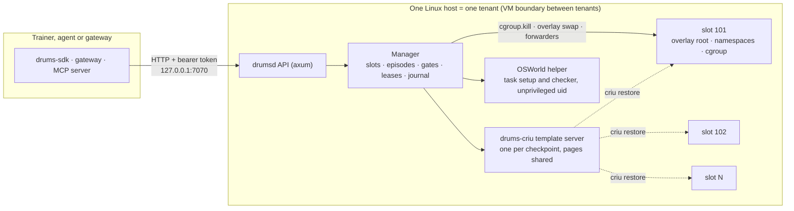

<p align="center">
  <picture>
    <source media="(prefers-color-scheme: dark)" srcset="https://raw.githubusercontent.com/Drums-Labs/drumsd/main/docs/assets/drums-logo-dark.svg">
    
  </picture>
</p>

<h1 align="center">drumsd</h1>

<p align="center">
  The host daemon of the Drums shared runtime: hundreds of isolated Linux desktops on one server, restored from CRIU
  checkpoints, forked and reset without a reboot, with a gate report and a reward audit on every episode.
</p>

<p align="center">
  <a href="https://github.com/Drums-Labs/drumsd/actions/workflows/ci.yml"></a>
  <a href="https://www.apache.org/licenses/LICENSE-2.0"></a>
  <a href="https://docs.drums.run"></a>
  <a href="https://pypi.org/project/drums-sdk/"></a>
  
</p>

<p align="center">
  <a href="https://drums.run">Website</a> ·
  <a href="https://docs.drums.run">Docs</a> ·
  <a href="https://bench.drums.run">Benchmarks</a> ·
  <a href="https://console.drums.run">Console</a>
</p>

## What it is

Training a computer-use agent needs thousands of isolated desktops, and the usual answer is one virtual machine per
desktop, each booting its own kernel, operating system and applications. Drums takes a different route: one Linux host
runs one booted desktop image, and every environment is a private copy-on-write state on top of it (its own overlay
root, its own pid, mount, network, ipc, uts and user namespaces, its own cgroup). An environment is not booted; it is
restored from a CRIU checkpoint of a running desktop, so a reset or a fork brings up Chrome, LibreOffice or GIMP where
they were, in seconds, and many environments share the image's pages.

drumsd is the daemon that owns those environments on a host. It creates, resets, saves (captures), forks (branches),
quarantines and destroys them; drives the Drums fork of CRIU ([drums-criu](https://github.com/Drums-Labs/drums-criu),
one template server per checkpoint); runs every episode behind a set of gates (restore fidelity, isolation, cgroup
limits, OOM kills, application crashes) so a trainer never sees a reward from a broken desktop; and audits each reward
(a second checker run, a redundant checker, a file-scope scan). It serves an HTTP API on the host that the Python SDK
([drums-sdk](https://pypi.org/project/drums-sdk/)), the Drums gateway and the MCP server talk to.

One host serves one tenant. Environments on a host are separated from each other by namespaces, cgroups and per-env
uid ranges; customers are separated from each other by virtual machines. See [Security](#security).

## Quickstart

### 1. A host

A fresh Ubuntu 24.04 x86_64 machine with cgroup v2 (the default), 16 vCPU, 32 GiB of RAM and a 150 GiB disk, with
outbound HTTPS during the install. Every release is tested on an AWS c8i.4xlarge. Details, the list of hosts the
installer downloads from, and how many environments fit: [docs/host-requirements.md](docs/host-requirements.md).

### 2. Install from a release tarball

A release is one self-contained tarball, `drums-release-<commit>.tar.gz`, from the
[releases page](https://github.com/Drums-Labs/drumsd/releases). Every input it needs (apt snapshot, the OSWorld image,
the drums-criu and SDK commits, the Rust toolchain, a hashed Python lock) is pinned in `install/lock.json` and verified;
the first mismatch stops the install.

```bash
tar xzf drums-release-*.tar.gz
cd drums-release-*/
sudo ./install.sh
```

It takes 7 to 15 minutes on a 16-vCPU host and prints a progress line every 30 s. At the end it prints the API URL
(`http://127.0.0.1:7070`) and where the token is: `/etc/drums/token` (root only, mode 0600; it is never printed).
Running `install.sh` again is safe. Log: `/var/log/drums-install.log`.

Options (`sudo ./install.sh --help`):

| flag | effect |
|---|---|
| `--remote` | bind every interface instead of 127.0.0.1 (plain HTTP with a bearer token: private networks only; prefer an ssh tunnel) |
| `--port 7070` | API port |
| `--host-usd-per-hour X` | the host's price, for the cost metrics (default: looked up for the EC2 instance type, else 0) |
| `--state-tmpfs-gib N` | size of the RAM-backed state directory (default: half of RAM) |
| `--swap-mib N` | swap per environment (needs host swap; default 0) |
| `--procview` | the opt-in per-environment memory and CPU view ([docs/procview.md](docs/procview.md)) |
| `--trusted-unhardened` | turn the hardened profile off: trusted code only, root in an env is root on the host ([docs/security.md](docs/security.md)) |

### 3. Connect

From your laptop, tunnel the API (`ssh -L 7070:127.0.0.1:7070` to the host), then install the SDK and point it at the
daemon. The SDK is standard-library Python, 3.9 or later; the release also ships the same wheel under
`/opt/drums/sdk/` for hosts without PyPI access.

```bash
python3 -m venv ~/drums-venv
~/drums-venv/bin/pip install drums-sdk
```

```bash
export DRUMS_URL=http://127.0.0.1:7070
export DRUMS_TOKEN=$(ssh YOUR_HOST sudo cat /etc/drums/token)
```

(On the host itself: `export DRUMS_TOKEN=$(sudo cat /etc/drums/token)`.)

### 4. A first episode

Create an environment on an OSWorld task, act, fork the reached state into four copies, score each copy, save a state.

```python
import drums

with drums.connect() as client:                          # DRUMS_URL, DRUMS_TOKEN; closes this client's envs at the end
    client.reset_metrics()                               # the cost window starts now
    with client.create(task="e0df059f") as env:          # an OSWorld task id, a JSON path, or a dict
        env.wait_valid()                                 # every gate of this episode passed (5 s after ready)
        obs = env.observe()                              # obs.png: 1920x1080 PNG; obs.meta: instruction and more
        env.step("pyautogui.hotkey('ctrl', 'alt', 't')")  # pyautogui code, or an action dict
        with env.fork(4, keep_state=False) as kids:      # 4 independent copies of the reached state
            for k in kids:
                k.step({"type": "execute", "command": ["ls", "Desktop"]})
                r = k.verify(strict=False)               # the task's checker, with the episode's validity
                print(k.id, r.score, r.valid, r.invalid_reasons)
        state = env.save()                               # later: client.create(from_state=state)
        client.delete_state(state)                       # or let its lease delete it (30 min unused)
    print(client.metrics()["cost"])                      # USD per valid episode and per verified reward
```

Train only on rewards whose `valid` is `True`: with the default `strict=True`, `verify()` raises `InvalidEpisode`
instead of returning a reward from an invalid episode. A longer loop that cannot leak environments is
[examples/rl_loop.py](examples/rl_loop.py); the SDK itself is documented at
[docs.drums.run](https://docs.drums.run).

## How it works



- **Checkpoints and template servers.** The installer boots the OSWorld desktop once and checkpoints it with drums-criu
  as the image checkpoint (`osworld-ubuntu`). Each checkpoint gets a long-lived template server that holds its pages;
  every environment made from it is a `criu restore` against that server, so restored desktops share memory and a
  restore is a page map, not a boot.
- **Slots.** An environment is a slot: a numbered directory with its own overlay upper layer, a leaf cgroup (CPU and
  memory limits, OOM accounting), listeners for its guest ports, and, in the hardened profile, its own user namespace
  and host uid range. A reset kills the old tree with `cgroup.kill`, swaps in a spare upper layer prepared in the
  background and restores into the other leaf of the slot.
- **Fork, save, reset.** `capture` dumps a running environment into a new checkpoint (incremental on top of its last
  base; only after the process tree has been quiescent for a window, and the dump is checked against the tree).
  `branch` restores N children from it. Everything a trainer forgets is reaped by leases.
- **Gates and validity.** Every create, reset and fork child starts an episode with a gate report (`lock_applied`,
  `cgroup`, `init_identity`, `mount_table`, `netns`, `guest_ready`, `state_hash`, `isolation`, `alive_after_resume`,
  `no_oom_kill`, `no_app_crash`, `not_quarantined`). A failed gate quarantines the slot; an episode is `valid` only when
  every gate passed. [docs/validity.md](docs/validity.md).
- **Reward audit.** Every `verify` reply carries an `audit` block: checker timing and error class, a second checker run,
  an optional redundant checker, and a file-scope scan against the task's manifest. [docs/reward-audit.md](docs/reward-audit.md).
- **Crash safety.** Slot and checkpoint records are journaled (write, fsync, rename) before work starts; on start
  drumsd reconciles what it finds, adopts running environments and template servers, and marks the rest down.
  [docs/architecture.md](docs/architecture.md) has the full picture.

## Configuration

drumsd reads one JSON file (`/etc/drums/drumsd.json`, written by the installer; `drumsd serve --config PATH`). The
fields, from [`crates/drumsd/src/config.rs`](crates/drumsd/src/config.rs). "Required" fields have no default.

| field | default | meaning |
|---|---|---|
| `listen` | `"127.0.0.1:7070"` | address the API binds to; a non-loopback address needs `allow_remote` |
| `allow_remote` | `false` | allow a non-loopback `listen` (token-protected, not encrypted: use a tunnel or a private network) |
| `token_file` | required | file holding the API bearer token (32+ characters, mode 0600); drumsd refuses to start without it |
| `state_dir` | required | the runtime's state directory (`slot<N>/` directories; the RAM-backed tmpfs) |
| `journal_dir` | required | drumsd's own records: slot and checkpoint JSON plus `events.jsonl` |
| `lower` | required | read-only lower layer of every slot (the attached OSWorld image) |
| `image_sha256` | required | sha256 of that image, checked against checkpoints |
| `py_src` | required | checkout of the runtime's Python side (`sharedos_rootfs`, used for the capture verb) |
| `py_config` | required | `SHAREDOS_ROOTFS_CONFIG` for those verbs |
| `python` | `null` | Python interpreter for them (default: `/usr/bin/python3`) |
| `criu` | required | the drums-criu binary (template servers, restores, dumps) |
| `vcpus` | required | `cpu.max` of each slot, in vCPUs |
| `memory_mib` | required | `memory.max` of each slot |
| `swap_mib` | `0` | `memory.swap.max` per slot; 0 = none (needs host swap to matter) |
| `procview_dir` | `"/run/drums/procview"` | mount of the per-env memory/CPU view (`drumsd procview`); checkpoints that bind it are restored with those binds |
| `port_base` | required | guest-server port of slot N is `port_base + N` |
| `guest_port` | `5000` | the guest server's port inside the desktop |
| `extra_ports` | `[]` | more forwarders, as `[host_base, guest_port]` pairs; slot N listens on `host_base + N` |
| `slot_range` | `[100, 2000]` | slot numbers drumsd allocates from (inclusive start, exclusive end) |
| `max_concurrent_restores` | `4` | restores in flight at once (the installer sets 3/8 of the vCPUs, at least 4) |
| `natural_exits` | `[]` | process names that exit by themselves after a restore (not counted by the alive gate) |
| `alive_after_s` | `5.0` | seconds after ready before the `alive_after_resume` gate is judged |
| `max_attempts` | `3` | restore attempts per create/reset (only failures before any restored task ran are retried) |
| `warm_upper` | `true` | prepare the next upper layer in the background instead of copying on the critical path |
| `async_kill` | `true` | two leaf cgroups per slot: a reset kills the old tree without waiting and restores into the other |
| `netns_fast` | `true` | restore with `--empty-ns net` and let the hook bring `lo` up, instead of CRIU's ip/iptables restore |
| `restore_cpu_boost` | `true` | lift `cpu.max` while CRIU restores (no restored task runs yet) and put it back at pre-resume |
| `restore_cpu_weight` | `10000` | `cpu.weight` of a slot from restore start to the end of task setup, and of a capture's parent during its dump; 0 = off |
| `prefork_max_age_s` | `120.0` | a prefork (`POST /v1/slots/{id}/prefork`) nobody claimed within this many seconds is discarded |
| `prefork_quiesce_window_s` | `0.1` | quiet window a prefork's capture waits for |
| `daemon_cpu_weight` | `1000` | `cpu.weight` drumsd writes on its own cgroup at start; 0 = leave it |
| `resident_capture_verb` | `true` | captures run through resident `capture serve` workers instead of one Python process each |
| `incremental_capture` | `true` | dump only the pages written since the environment's last base (`--track-mem`, `--prev-images-dir`) |
| `incremental_max_depth` | `8` | longest parent chain of incremental captures before the next capture is a full dump |
| `nested_pidns` | `false` | pass `--nested-pidns` on restore (sandboxed apps that nest pid/user/net namespaces) |
| `criu_log_level` | `3` | CRIU log level for dumps, restores and template servers (3 or 4) |
| `crash_watch` | `true` | the `no_app_crash` gate: watch kernel process events for crash-signal exits; drumsd refuses to start if it cannot open the watch |
| `osw` | `null` | OSWorld task setup and checkers (block below); without it, tasks and `verify` are unavailable |
| `host_usd_per_hour` | `0.0` | the host's price, for the cost metrics; 0 = cost not reported |
| `quiesce` | block below | capture readiness |
| `admission` | block below | admission control for create, capture and fork |
| `forgotten_dir` | `null` | where records of destroyed envs, deleted states and rejected dumps go; default `<parent of journal_dir>/forgotten` |
| `forgotten_max_gib` | `null` | a cap over every kept record of both classes, oldest first; unset = none (setting it can delete failure records) |
| `retention` | block below | what is kept of a destroyed env, and the per-class caps |
| `forgotten_warn_gib` | `50.0` | `/v1/health` warns when full records exceed this |
| `state_min_free_mib` | `1024` | restores and captures are refused (`state_dir_full`) below this much free space in the state dir |
| `state_warn_free_pct` | `15.0` | `/v1/health` warns when the state dir's free space falls below this percentage |
| `lease` | block below | defaults for reaping unused envs and saved states |

`lease` (a request's `idle_timeout_s` / `ttl_s` override these; `null` or 0 turns a limit off):

| field | default | meaning |
|---|---|---|
| `env_idle_timeout_s` | `1800` | an env with no API request naming it for this long is destroyed |
| `env_ttl_s` | `null` | an env is destroyed this long after it was created |
| `state_idle_timeout_s` | `1800` | a saved state with no env made from it for this long is deleted |
| `state_ttl_s` | `null` | a saved state is deleted this long after it was made (once no env made from it exists) |
| `reap_interval_s` | `15.0` | how often the reaper looks |

`retention`:

| field | default | meaning |
|---|---|---|
| `mode` | `"failures_full"` | `failures_full`: failed, invalid, quarantined and rejected envs keep a full `.tar.zst`, valid ones a small summary; `keep_all`: every env keeps a full archive |
| `summary_max_gib` | `2` | summaries beyond this are deleted, oldest first; `null` = no cap |
| `full_max_gib` | `null` | full records beyond this are deleted, oldest first; unset = failure records are never pruned |

`quiesce` (before every capture the tree must be quiescent, and the dump must match it):

| field | default | meaning |
|---|---|---|
| `window_s` | `1.0` | no task leaving, no process or thread starting or exiting for this long |
| `timeout_s` | `30.0` | give up (`not_quiescent`) after this long |
| `poll_ms` | `50` | sampling interval when the window is sampled |
| `max_attempts` | `3` | dumps tried within `timeout_s` when a dump is rejected |
| `confirm_s` | `0.0` | hold the new checkpoint this long after the dump started before the source check; 0 = check at once |
| `events` | `true` | prove the window from kernel process events when they cover it, so an already-quiet tree is captured at once |

`admission` (a refusal is HTTP 429, code `overloaded`; nothing is started):

| field | default | meaning |
|---|---|---|
| `enabled` | `true` | off: everything is admitted |
| `min_available_pct` | `8.0` | `MemAvailable` that must remain after the admitted work, as a percent of `MemTotal`... |
| `min_available_mib` | `4096` | ...and at least this many MiB |
| `env_mib` | `1024` | expected memory of one new env |
| `capture_mib` | `2048` | expected memory of one capture |
| `max_memory_psi_some_avg10` | `10.0` | refuse while `/proc/pressure/memory` `some avg10` is above this |
| `min_state_free_mib` | `8192` | free space the state tmpfs must keep after the admitted work |

`osw`:

| field | default | meaning |
|---|---|---|
| `python` | required | Python of the OSWorld venv |
| `helper` | required | `drums_osw.py` (setup, evaluate, stage) |
| `osworld_dir` | required | the OSWorld checkout at the pinned commit |
| `cache_dir` | required | shared download cache (`<cache>/<task id>/...`) |
| `uid`, `gid` | required | the helper runs as this user, never root |
| `setup_timeout_s` | `600` | task setup deadline |
| `eval_timeout_s` | `600` | checker deadline |
| `client_password` | `"password"` | sudo password of the image's user (OSWorld's `client_password`), used by trusted provisioning only |
| `verifiers_dir` | `null` | lab verifiers (`NAME.py`, root-owned); default `/etc/drums/verifiers` ([docs/custom-tasks.md](docs/custom-tasks.md)) |
| `assets_dir` | `null` | the only host directory a task's `upload_file` step may read; default `/var/lib/drums/assets` |

## API

Every route except `GET /healthz` needs `Authorization: Bearer <token>`. The full schema is
[`api/openapi.json`](api/openapi.json), also served at `GET /openapi.json`. The SDK's env, saved state, fork and save
are this API's slot, checkpoint, branch and capture.

| route | what it does |
|---|---|
| `GET /healthz` | liveness, no auth |
| `GET /v1/health` | host health: slots by state, template servers, admission, crash watch, state dir and record space, warnings |
| `GET /v1/metrics` · `POST /v1/metrics/reset` | aggregate metrics for the current window (latency, episodes by verdict, failures, cost) · start a new window |
| `GET /metrics` | the same as Prometheus text |
| `GET /openapi.json` | this API's schema |
| `GET /v1/checkpoints` · `POST /v1/checkpoints` | list checkpoints (installed images and saved states) · adopt a checkpoint made outside drumsd |
| `GET /v1/checkpoints/{id}` · `DELETE /v1/checkpoints/{id}` | one checkpoint · delete a saved state (`installed=true` for an image) |
| `GET /v1/slots` · `POST /v1/slots` | list envs (live ones by default) · create one from an image or saved state, optionally on a task |
| `GET /v1/slots/{id}` · `DELETE /v1/slots/{id}` | the slot record · destroy it (idempotent; a destroyed slot answers 410 `env_gone` elsewhere) |
| `POST /v1/slots/{id}/reset` | kill the tree and restore the checkpoint again: a new episode |
| `POST /v1/slots/{id}/step` | run an action in the desktop (pyautogui code or an action dict) |
| `GET /v1/slots/{id}/screenshot` | a 1920x1080 PNG of the desktop |
| `GET /v1/slots/{id}/gates` | the gate report of the current episode |
| `POST /v1/slots/{id}/capture` | save: dump the running env into a new checkpoint |
| `POST /v1/slots/{id}/branch` | fork: restore N children from the env's state |
| `POST /v1/slots/{id}/prefork` | dump ahead of time so a later fork of the same state is a restore only |
| `POST /v1/slots/{id}/quiescent` | wait until the tree is quiescent (what capture waits for) |
| `POST /v1/slots/{id}/task` | load an OSWorld or custom task into a running env |
| `POST /v1/slots/{id}/verify` | run the task's checker: score, validity, audit |
| `GET /v1/slots/{id}/metrics` | per-slot metrics |
| `POST /v1/slots/{id}/quarantine` · `POST /v1/slots/{id}/release` | take an env out of service with a reason · release it (then reset) |
| `GET /v1/tasks` · `GET /v1/tasks/{id}` | the OSWorld tasks the host knows, with their supported flag · one task |
| `POST /provision/{token}/setup/execute` | internal: one task setup step that needs root, run by drumsd as trusted provisioning, never by the agent |

## Development

Rust 1.96 (`install/lock.json`, `rust_toolchain`) and Linux. macOS builds and tests `drumsd-core`, `drumsd-os` and
`drums-pool` only; `drumsd-linux` and `drumsd` need Linux (`aya`, namespaces, cgroups). CI runs exactly these on
`ubuntu-latest`:

```bash
cargo fmt --all -- --check
```

```bash
cargo clippy --workspace --all-targets -- -D warnings
```

```bash
cargo test --workspace
```

The `forget` tests call `tar --zstd`, so install `zstd`. Four tests skip themselves when not root (they print
`skipped: needs root`): the uid-range shift and the sealed saved state in `idrange`, the nested pid namespace in
`procfs`, the netns forwarder in `proxy`. To run them too:

```bash
sudo -E cargo test --workspace
```

The Python and shell pieces have their own tests, and CI runs shellcheck over `install/*.sh`:

```bash
python3 -m unittest install/tests/test_build_wheel.py
```

```bash
python3 -m unittest discover -s osw/tests
```

```bash
for t in install/tests/test_*.sh; do bash "$t"; done
```

```bash
shellcheck -S warning install/*.sh
```

Changes to restore, gates, lifecycle or the installer are gated by the host tests, run as root on an installed host
against the real daemon (`tests/host/integration_host.py`, `tests/host/recovery_host.py` and friends). Which tests gate
which change, the fork gate, the CRIU pin bump procedure and how a release is cut: [CONTRIBUTING.md](CONTRIBUTING.md).

Workspace: `crates/drumsd-core` (records, gates, journal, leases, admission), `crates/drumsd-linux` (cgroups,
namespaces, mounts, uid ranges, crash watch, procview), `crates/drumsd` (the daemon: API, manager, config),
`crates/drums-pool` (many hosts behind one API) and `crates/drumsd-os` (Android and Windows pools, `drumsd serve-os`).
`osw/` is the OSWorld bridge, `install/` the installer and release builder, `tests/host/` the host tests, `examples/`
the SDK examples. `pool/`, `osvm/` and `tenantvm/` hold the tooling behind the published measurements.

## Benchmarks

[bench.drums.run](https://bench.drums.run) is the public record: every number there names its hardware, workload,
method and sample size, and failed and planned runs stay on the record. Numbers measured on the release host type
(c8i.4xlarge, 16 vCPU, 32 GiB, scripted actions, one host, not a comparison) are in
[docs/host-requirements.md](docs/host-requirements.md): 40 idle environments at once, all valid; 60 of 60 episodes
valid over 20 environments running Chrome and LibreOffice tasks. 128 and 256 environments per host were run on an
r8i.16xlarge (496 GiB). Incumbent comparisons on the site are labelled paired or unpaired and replicated or not; read
the label before the number.

## Security

The security model is [docs/security.md](docs/security.md); how to report a vulnerability, which versions get fixes
and the known limits are in [SECURITY.md](SECURITY.md). In short: environments run in the hardened profile by default
(own user namespace with an unprivileged host uid range, `no_new_privs`, a capability bounding set, seccomp, a
metadata firewall, no network); the agent never gets root, and task setup steps that need it run as drumsd's trusted
provisioning; the API binds to loopback and always needs a token. Isolation between environments is namespaces and
cgroups inside one trusted customer's boundary. It is not a microVM and not a boundary between tenants: tenants get
separate virtual machines.

## Contributing

[CONTRIBUTING.md](CONTRIBUTING.md): build, the tests that gate a change, the fork and zdtm gates, releases, and what a
pull request needs. Please read the [code of conduct](CODE_OF_CONDUCT.md). Bug reports and feature requests use the
issue templates.

## License

Apache License 2.0 for the code in this repository. Two things it depends on are licensed differently and run as
separate programs: [drums-criu](https://github.com/Drums-Labs/drums-criu), the CRIU fork, is GPL-2.0 and is driven
over its command line and files (the release ships its source bundle next to the binary); the eBPF program of the
opt-in procview (`crates/drumsd-linux/bpf/sysinfo.bpf.c`) is dual-licensed GPL-2.0-only OR MIT because the kernel
requires a GPL-compatible licence for the helpers it uses. The OSWorld checkout, its Python dependencies and the
desktop image are downloaded by the installer under their own licences and are not redistributed here.

## Status

Beta. Stable and covered by the host tests on every release: create, reset, step, screenshot, capture, branch, verify,
destroy, the gate set, leases, retention, crash recovery, the installer on Ubuntu 24.04. Opt-in and less travelled:
procview, `drums-pool` (many hosts), `drumsd-os` (Android and Windows pools). Not supported yet: images other than the
pinned OSWorld Ubuntu image, GPUs, network access from inside a desktop. Releases are tagged `vX.Y.Z` on this
repository with the matching drums-criu and SDK tags; the changelog is [CHANGELOG.md](CHANGELOG.md). The Cargo
crate version (`0.4.2`, what `/v1/health` reports as `version`) is the internal runtime line the daemon came
from, not the release tag; aligning the two is proposed for v0.2.2.
